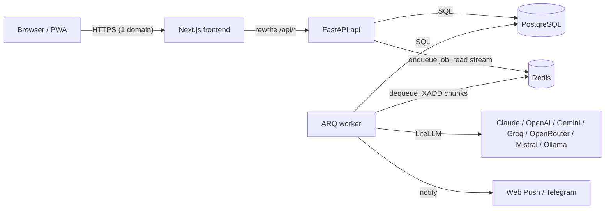

# Arsitektur

## Alur pesan

1. `POST /chats/{id}/messages` menyimpan pesan user, membuat `jobs` (status `queued`, idempotency key opsional), `enqueue_job("run_job")`, lalu langsung membalas `{job_id}` (HTTP 202). Tidak ada panggilan AI di request HTTP.
2. Worker meng-*claim* job secara atomik → `running`, memuat history + agent + setting user.
3. **Semantic cache** (pesan pertama saja) → kalau hit, jawaban lama dikirim dan job selesai tanpa memanggil provider.
4. **Token Saver**: normalisasi → dedupe → rolling summary → sliding window (`services/token_saver.py`, `summarizer.py`).
5. **Router** (`services/router.py`) menyusun daftar model: manual = model itu (+ fallback bila `allow_fallback`), `auto` = heuristik coding/kompleks → tier kuat, ringan → tier hemat, mengikuti urutan fallback user.
6. Untuk tiap model: **KeyPool.stream** mencoba key sesuai strategi (fill_first / round_robin / least_used). Setiap chunk → `XADD jobstream:{id}` (untuk SSE) dan `jobs.partial_output` (flush tiap 0,5 dtk).
7. Selesai: dalam satu transaksi simpan pesan assistant + `usage_logs` (unik per job → tidak dobel tagihan) + status `done`; kirim event `done` dan notifikasi.
8. Semua key habis → `waiting_quota` dengan `retry_at` = waktu pulih paling awal. Cron `resume_waiting` (tiap 30 dtk) memulihkan key yang cooldown-nya lewat dan meng-enqueue ulang job yang jatuh tempo; partial output dipertahankan dan dilanjutkan.

## SSE & sambung ulang

`GET /jobs/{id}/stream` hanya membaca Redis Stream (`XREAD BLOCK`), tidak pernah menjalankan AI. Tanpa `Last-Event-ID` → replay dari awal; dengan `Last-Event-ID` → lanjut dari event berikutnya; stream sudah kedaluwarsa → `snapshot` dari DB. Frontend (`lib/sse.ts`) reconnect otomatis dengan backoff dan saat halaman dibuka mengecek job aktif di chat itu (`GET /jobs?chat_id=..&limit=1`).

## Status key

| Status | Masuk karena | Keluar |
|---|---|---|
| `active` | default / sukses | - |
| `cooling_down` | 429 | `cooldown_until` lewat (otomatis) |
| `exhausted` | 402 / quota / credit / kuota harian | `reset_at` (00:00 UTC) atau diaktifkan manual |
| `invalid` | 401 / 403 | hanya manual (tes ulang / aktifkan) |
| `disabled` | dimatikan user | diaktifkan user |

## Keamanan

- API key: AES-256-GCM, nonce acak 12 byte disimpan di depan ciphertext (`core/encryption.py`). Respons hanya berisi `key_hint` (`sk-...abcd`).
- Password argon2; JWT access 15 menit + refresh 7 hari (rotasi, bisa dicabut, logout mencabut).
- Rate limit Redis per user dan per IP; login/register lebih ketat. Batas job paralel per user, panjang pesan, jumlah chat, jumlah key, timeout job (ARQ `job_timeout`).
- Log JSON terstruktur (`job_id`, `user_id`, `provider`, `key_id`), redaksi otomatis pola API key / Bearer / `password=`; isi chat tidak di-log.
- Setiap resource dicek kepemilikannya (404 untuk milik user lain).

## Modul

| Path | Isi |
|---|---|
| `backend/app/api/` | router FastAPI (auth, providers, models, agents, chats, jobs, usage, settings, health) |
| `backend/app/services/key_pool.py` | rotasi key, lease, penandaan status |
| `backend/app/services/jobs.py` | `JobRunner` (inti worker) |
| `backend/app/services/llm.py` | adapter LiteLLM + normalisasi error + provider mock |
| `backend/app/worker.py` | entrypoint ARQ + cron |
| `frontend/components/ChatView.tsx` | chat, ModelPicker, panel agent, stream |
| `frontend/components/KeyPoolCard.tsx` | key pool per provider |
